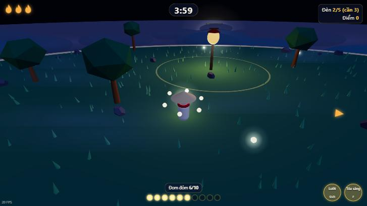

# Đảo Đèn Lồng

> **Video demo:** _(link video .mp4 trong GitHub Release v1.0.0)_ · **Bản chạy được:** GitHub Release `v1.0.0` (thư mục web tĩnh `dao-den-long-v1.0.0-web.zip`)
> Day 12 · AI SDLC Lab · Nguyễn Khắc Khánh · 2A202603472. Tài liệu lab gốc: [docs/lab/](docs/lab/README.md)

Game 3D góc nhìn thứ ba (Three.js, chạy trên trình duyệt). Mây, người giữ đèn nhỏ tuổi đội nón lá, đi qua 3 Đêm trên 3 hòn đảo: gom đom đóm, thắp và **giữ** các Đèn Lồng Lớn sáng tới bình minh, tránh Bóng Mực (hút dầu đèn) và Gió Lạc (cướp đom đóm).



## Yêu cầu hệ thống

- Node.js ≥ 20 (macOS, Linux hoặc Windows)
- Trình duyệt có WebGL 2 (Chrome, Edge, Firefox, Safari bản gần đây)
- Benchmark cần Chrome hoặc Edge đã cài, nếu không thì chạy `npx playwright-core install chromium` một lần
- Khuyến nghị: GPU rời hoặc iGPU đời mới, RAM ≥ 8 GB

## Cài đặt và chạy (3 lệnh)

```bash
npm ci
npm run build
npm start          # mở http://localhost:4173 (server cục bộ + lưu bảng xếp hạng trên đĩa)
```

Phát triển: `npm run dev`. Bản tĩnh trong Release: giải nén rồi mở bằng bất kỳ server tĩnh nào (vd. `npx serve dist`); khi đó bảng xếp hạng được lưu trong trình duyệt.

## Điều khiển (đổi được trong Cài đặt)

| Phím mặc định | Hành động |
|---|---|
| W A S D | Đi (theo hướng camera) |
| Kéo chuột / ← → | Xoay camera (độ nhạy chỉnh trong Cài đặt) |
| Space | Nhảy |
| Shift | Lướt (14 m/s trong 0.2 s, hồi chiêu 1.5 s) |
| E | Nạp đom đóm vào đèn tắt / châm dầu cho đèn đang sáng (trong 2 m) |
| F | Tỏa Sáng: tốn 3 đom đóm, làm choáng và đẩy lùi Bóng Mực trong 5 m |
| Esc | Tạm dừng: Tiếp tục / Chơi lại Đêm / Cài đặt / Về menu |

**Cài đặt (được lưu):** âm lượng, độ nhạy chuột, đổi phím (báo trùng, khôi phục mặc định), bảng màu dễ phân biệt cho người mù màu, giảm chuyển động (tắt rung camera và chớp màn hình), chữ lớn ×1.25. Phụ đề cảnh báo khi Bóng Mực xuất hiện (kèm mũi tên ở mép màn hình), gió sắp thổi, 10 giây cuối, đèn sắp hết dầu.

## Ba Đêm

| Đêm | Đảo | Đèn (cần giữ khi bình minh) | Thời gian | Điểm mới |
|---|---|---|---|---|
| 1 | Đảo Bến: đảo tròn 40 m | 5 (≥ 3) | 240 s | |
| 2 | Đảo Cau: hai đảo nối bằng cầu tre | 6 (≥ 4) | 270 s | Bục nhảy, Gió Lạc, Bùa Gió |
| 3 | Đảo Chuông: ba tầng, dốc, tháp chuông | 7 (≥ 5) | 300 s | Gió mạnh mỗi 30 s, Bóng Mực nhanh hơn |

Menu → giới thiệu Đêm (lời Ông Đăng) → chơi → kết quả → Đêm kế tiếp. Thắng Đêm 3 thì tới màn hình Bình Minh. Thua thì chơi lại Đêm đó. Sau Bình Minh hoặc khi thua, nhập tên để lưu vào **Bảng xếp hạng** (top 10, có ở menu chính).

## Luật và điểm

- **Mục tiêu:** còn Ngọn Lửa khi hết giờ và số đèn đang sáng ≥ 60% tổng đèn. Thắp hết đèn không kết thúc Đêm.
- **Dầu đèn:** đèn vừa thắp có 100 dầu, hao 1/giây; mỗi đom đóm châm +10. Hết dầu thì đèn tắt; thắp lại cần 5 đom đóm (lần đầu 10). Vùng an toàn 6 m chỉ có khi dầu ≥ 30; dưới 30 thì Bóng Mực tới hút dầu 5/giây.
- **Sức chứa** 10, +2 mỗi lần thắp thành công, tối đa 20. Bị Bóng Mực chạm: −1 lửa, rơi một nửa số đom đóm. Rơi khỏi đảo: −1 lửa, mất hết đom đóm.

| Sự kiện | Điểm |
|---|---|
| Mỗi đom đóm nạp vào đèn (thắp, thắp lại, châm dầu) | +5 |
| Thắp lần đầu / thắp lại | +100 / +40 |
| Mỗi Bóng Mực trúng Tỏa Sáng (đang hút dầu) | +5 (+15) |
| Bình minh (khi thắng): mỗi đèn đang sáng | +50 + số dầu còn lại |
| Bình minh (khi thắng): mỗi Ngọn Lửa còn lại | +50 |

## Kiểm thử, headless, benchmark, soak (Test Contract v1.3)

```bash
npm test                                               # 78 test: unit + scenario headless cả 3 Đêm + bench/soak/bảng xếp hạng
npm run verify -- --phase 4                            # chạy kiểm chứng, lưu bằng chứng vào docs/proof/phase-4
node src/headless.js --seed 1 --night 1 --ticks 600 --out out.jsonl [--scenario s.json] [--inputs i.json] [--snapshot-every 10]
npm run bench -- --seed 42 --duration 30 --out bench.json   # mở cửa sổ 1280×720, cảnh bench chuẩn, ghi bench.json
npm run soak -- --seed 7 --nights 10 --out soak.json        # 10 Đêm headless liên tiếp, ghi soak.json
node scripts/run.mjs --export-leaderboard out.json          # xuất bảng xếp hạng {"entries": [...]}
```

- **Benchmark:** chạy game trong Chrome/Edge (qua `playwright-core`) với `--disable-gpu-vsync --disable-frame-rate-limit`, nên **vsync được tắt**. Trong cảnh bench, phần trang trí và hiệu ứng sáng tạo (cây cỏ, mây, sương, hào quang Bóng Mực) được tắt theo Ticket-04. `peak_mem_mb` là tổng RSS của cây tiến trình trình duyệt.
- **Soak:** trước Đêm đầu có bước khởi động JIT (tắt bằng `--no-warmup`). Lý do và số đo cả hai cách: [bằng chứng Phase 4](docs/proof/phase-4/README.md).
- Kết quả tự đo: [bench.json](bench.json), [soak.json](soak.json), [các lần đo](docs/proof/phase-4/bench-runs.md).
- Khai báo: [game.contract.json](game.contract.json) (v1.3). Thay đổi qua các phase: [CHANGELOG.md](CHANGELOG.md). Quyết định thiết kế: [ADR-001](docs/adr/ADR-001-lantern-fuel-and-dawn-win.md).
- Spec: [PRD-0](docs/requirements/PRD-0.md), [Ticket-02](docs/requirements/TICKET-02.md), [Ticket-03](docs/requirements/TICKET-03.md), [Ticket-04](docs/requirements/TICKET-04.md). Giả định: [assumptions.md](docs/notes/assumptions.md).
- Bằng chứng: [Phase 1](docs/proof/phase-1/README.md), [Phase 2](docs/proof/phase-2/README.md), [Phase 3](docs/proof/phase-3/README.md), [Phase 4](docs/proof/phase-4/README.md). Retro: [docs/notes/retro.md](docs/notes/retro.md).

## Cấu trúc

```text
src/core/        level.js (bản đồ), game.js (logic tất định), bench.js (cảnh bench), leaderboard.js, inputs.js, rng.js
src/headless.js  CLI theo Test Contract
src/render/      main.js (màn hình, HUD, cài đặt, bench), world.js (cảnh 3D), decor.js (trang trí), audio.js (WebAudio)
scripts/         run.mjs (server + bảng xếp hạng), bench.mjs, soak.mjs, verify.mjs
tests/           unit + scenario headless (Phase 1–4)
docs/            requirements, adr, notes (giả định, nhật ký AI, retro), proof
AGENTS.md, CLAUDE.md, .claude/ (hook Stop, skill verify), .github/workflows/ci.yml
```

## Harness AI

- `AGENTS.md`: lệnh, kiến trúc, quy tắc cho agent (`CLAUDE.md` trỏ tới file này), cập nhật qua 4 phase.
- Hook `Stop`: chặn agent kết thúc lượt khi `npm test` đỏ.
- Skill `verify`: kiểm chứng, tất định, hiệu năng, lưu bằng chứng theo phase.
- CI GitHub Actions: build, test, headless smoke trên Ubuntu và macOS.
- Skill tham khảo dùng local, không commit: gamedev-skills (game-ai, game-ui-ux, audio-design, performance-optimization, threejs-*).

## Sáng tạo của tôi

- Đom đóm đang mang bay vòng quanh Mây; vòng sáng vùng an toàn quanh đèn; Bóng Mực bò lên từ sương khi `spawning`.
- Lời Ông Đăng cho từng Đêm, màn hình Bình Minh.
- Bầu trời sao có trăng, biển mây trôi, sương, cỏ/đá/cây (cây cau ở Đêm 2), quầng sáng cho đèn và đom đóm.

Tất cả chỉ nằm trong `src/render/`, không đổi output headless và được tắt trong cảnh bench. Bằng chứng: toàn bộ test vẫn xanh ([test-output.txt](docs/proof/phase-4/test-output.txt)).
